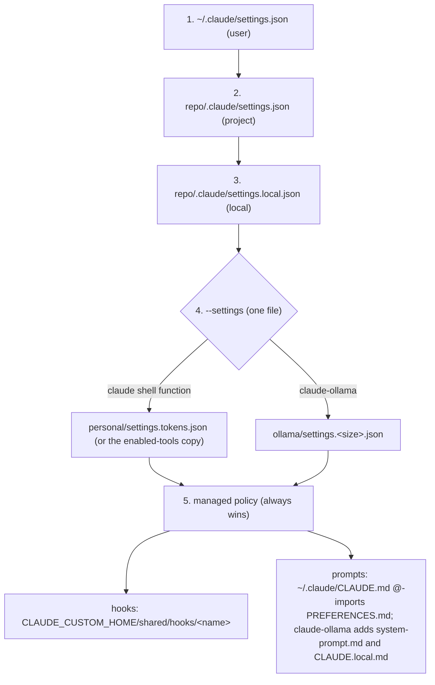

# Layer order (higher number wins for scalars; lists such as `permissions.*` and `hooks.*` concatenate; `env` merges per key)

Below the diagram, the numbered list gives the same layers in order. Mermaid is
rendered by GitHub; in a terminal the source is still readable.

1. `~/.claude/settings.json` (user, never edited by this repo)
2. `<repo>/.claude/settings.json` (project, untouched)
3. `<repo>/.claude/settings.local.json` (local) ← `project/settings.local.json`
4. `--settings` (CLI layer, one file only): `personal/settings.tokens.json` via
   the `claude` shell function, or `ollama/settings.<size>.json` via
   `claude-ollama`
5. Managed policy (untouched, always wins)

`--settings` is a single slot. Passing it twice keeps only the last file, so
`claude --settings other.json` drops the personal overlay for that session. The
overlay denies tools you never use by bare name, so their schemas stay out of
the context; to get one back, delete its name from the deny list or run
`claude-tools <path>` and press `x`.

The overlay also turns Claude Code's own sandbox on (`sandbox.enabled`): shell
commands Claude runs can write only the working directory, the per-user temp
folder, added directories and the package caches (`~/.cache`,
`~/Library/Caches`, `~/.npm`, `~/go/pkg/mod`, the pnpm store and state folders
and bun's cache; never `~/.cache/claude-custom`, which holds the hooks' state
and the machine copy of this overlay), and reach loopback addresses, GitHub, the
npm, Go and PyPI registries and `context7.com` (the `/find-docs` skill) without
a prompt; the first use of any other host prompts once. When Claude wants to
retry a command outside the sandbox, the overlay's ask rule
`Bash(dangerouslyDisableSandbox:true)` prompts you in every permission mode.
Both overlays share that host list and cache list and set
`NODE_USE_ENV_PROXY=1`, so `npx ctx7` reaches Context7 through the sandbox
proxy; `claude-ollama` adds its own `excludedCommands`; both hide the same
credentials (`~/.ssh`, `~/.aws`, `~/.config/gh`, `~/.config/context7`,
`~/.npmrc`, the keychain) and the console state folder, unset `GH_TOKEN`,
`GITHUB_TOKEN` and `SHORTCUT_API_TOKEN`, and run `gh` and `git push` outside the
sandbox after a prompt (`permissions.ask`), since the gh credential helper needs
`~/.config/gh`; `git fetch` and `git pull` stay inside, so a private remote
needs a fetch by hand.

To get a tool back on one machine only, list its name (one per line) in
`~/.config/claude-custom/enabled-tools`. `personal/settings-path` then writes a
copy of the overlay without those denies to
`~/.cache/claude-custom/settings.tokens.json`, and the `claude` function loads
that copy instead (or the shared overlay if `jq` fails).

To turn Claude Code's sandbox off on one machine only, create an empty
`~/.config/claude-custom/sandbox-off`. The machine copy then sets
`sandbox.enabled` to false and `claude` prints a warning at every launch; every
other machine keeps it on. The console's `/machine` page shows `sandbox-off`,
edits `gh-repos` and `enabled-tools` with history, and never creates or deletes
`sandbox-off`.
