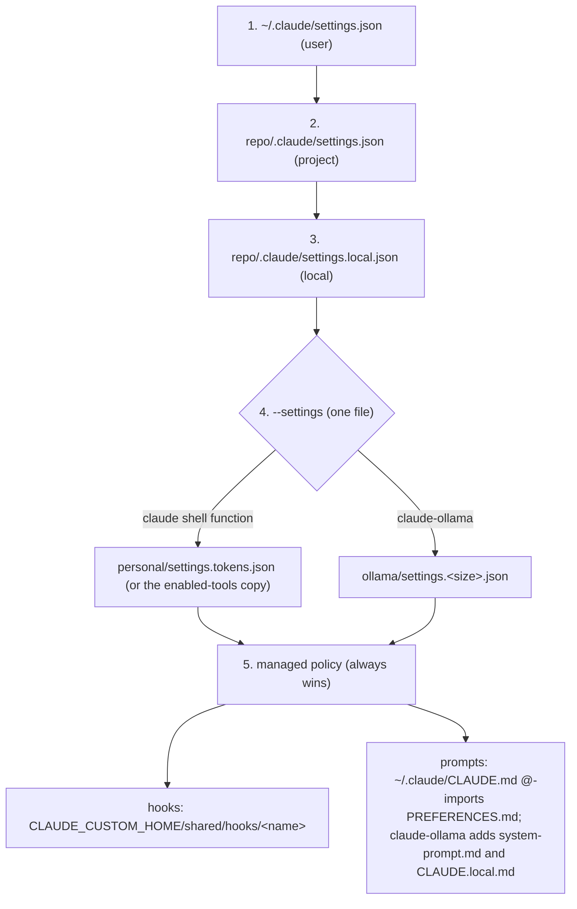

# Layer order (higher number wins for scalars; lists such as `permissions.*` and `hooks.*` concatenate; `env` merges per key)

Below the diagram, the numbered list gives the same layers in order. Mermaid is
rendered by GitHub; in a terminal the source is still readable.

1. `~/.claude/settings.json` (user, never edited by this repo)
2. `<repo>/.claude/settings.json` (project, untouched)
3. `<repo>/.claude/settings.local.json` (local) ← `project/settings.local.json`
4. `--settings` (CLI layer, one file only): `personal/settings.tokens.json` via
   the `claude` shell function, or `ollama/settings.<size>.json` via
   `claude-ollama`
5. Managed policy (untouched, always wins)

`--settings` is a single slot. Passing it twice keeps only the last file, so
`claude --settings other.json` drops the personal overlay for that session. The
overlay denies tools you never use by bare name, so their schemas stay out of
the context; to get one back, delete its name from the deny list or run
`claude-tools <path>` and press `x`.

The overlay also turns Claude Code's own sandbox on (`sandbox.enabled`): shell
commands Claude runs can write only the working directory, the per-user temp
folder and added directories, and reach only hosts you allow (the first use of a
new host prompts). When Claude wants to retry a command outside the sandbox, the
overlay's ask rule `Bash(dangerouslyDisableSandbox:true)` prompts you in every
permission mode. Both overlays let sandboxed commands write the pnpm, npm, Go,
pip and `~/.cache` caches and reach loopback addresses; `claude-ollama` adds its
own `excludedCommands`, `denyRead`, credential and registry lists.

To get a tool back on one machine only, list its name (one per line) in
`~/.config/claude-custom/enabled-tools`. `personal/settings-path` then writes a
copy of the overlay without those denies to
`~/.cache/claude-custom/settings.tokens.json`, and the `claude` function loads
that copy instead (or the shared overlay if `jq` fails).

To turn Claude Code's sandbox off on one machine only, create an empty
`~/.config/claude-custom/sandbox-off`. The machine copy then sets
`sandbox.enabled` to false and `claude` prints a warning at every launch; every
other machine keeps it on. The console's `/machine` page shows `enabled-tools`
and `sandbox-off`, edits `enabled-tools` with history, and never creates or
deletes `sandbox-off`.
